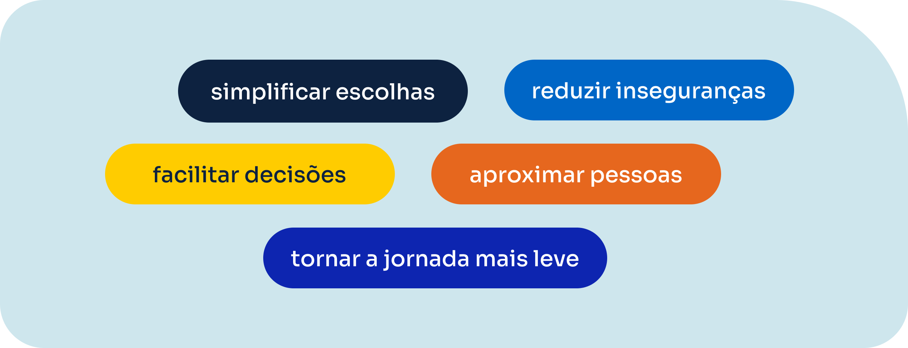

# A Quero Passagem

Fonte: Brand Navigator /design-na-qp/marca. Atualização na origem: 2026-08-12T15:50:09.41895+00:00.

> Transcrição da página publicada. Exemplos de interface e dados ilustrativos permanecem exemplos; não são políticas comerciais.

<!-- bloco 0 · b02a2ea6-a66b-429d-a438-5fcba77399f2 · section -->

A <strong>Quero Passagem</strong> nasce da crença de que o que queremos é o que nos move. Cada pessoa tem seus próprios caminhos, momentos e destinos, e viajar é uma das formas mais genuínas de seguir aquilo que faz sentido em cada fase da vida.

Por isso, construímos uma marca mais humana, acessível e confiável, capaz de transmitir movimento, proximidade e simplicidade.&nbsp;

Cada elemento foi pensado para reforçar nosso papel como facilitadores de jornadas, ajudando as pessoas a seguirem o que querem, do seu jeito, no seu tempo.

[Recurso na origem](https://wvolojruignlzoecvhwx.supabase.co/storage/v1/object/public/page-media/video/1786537487286-88b8h4.mp4)

<!-- bloco 2 · 1e692b9f-8839-43e4-abba-e91a3b9072c2 · section -->

<h2>A Quero Passagem se conecta com as pessoas</h2>

Nossa comunicação nasce da escuta. 
Este material foi construído a partir do comportamento real dos nossos clientes, entendendo quem são as pessoas que viajam com a gente, o que buscam, como se comunicam e quais motivos tornam cada viagem importante.  Em um país tão diverso quanto o Brasil, comunicar bem também significa comunicar de forma simples e acessível. Respeitamos diferentes formas de falar, contextos culturais, gerações e realidades. Por isso, nossa linguagem evita excessos, termos complicados e barreiras que afastam as pessoas. Preferimos clareza, naturalidade e proximidade.  Mais do que informar, queremos acolher, orientar e transmitir segurança em cada interação. 

<!-- bloco 2 · ebd661b9-619f-41e8-8eb6-9c19c24d3ba7 · section -->

<h3>Nossa comunicação é parte da experiência da marca.</h3>
Não falamos apenas sobre preço ou destino, escolhemos construir relações através da clareza, do cuidado e da proximidade. Cada mensagem existe para:

  

<h3>Porque viajar começa muito antes do embarque.
</h3><h3>Começa no momento em que alguém encontra segurança para seguir caminho.</h3>

