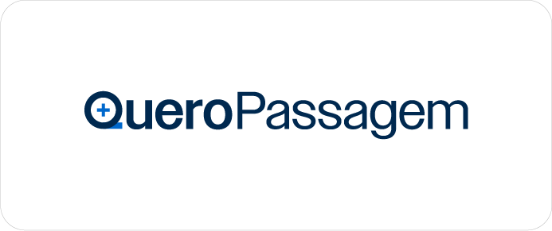
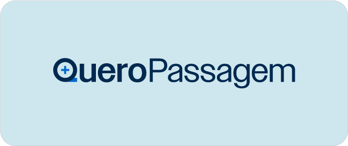
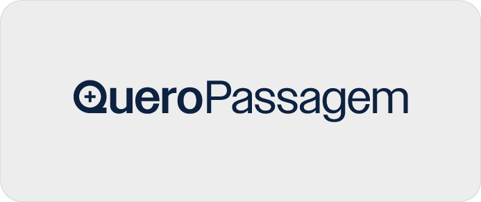

# Cores

Fonte: Brand Navigator /fundamentos/cores. Atualização na origem: 2026-08-11T20:46:47.512342+00:00.

> Transcrição da página publicada. Exemplos de interface e dados ilustrativos permanecem exemplos; não são políticas comerciais.

<!-- bloco 1 · cf56695e-1b63-4f66-959f-05165b993726 · section -->

<h3>Cores primárias</h3>
A base da nossa identidade. Tons fortes e vibrantes que garantem a força e o reconhecimento imediato da marca. O azul é a cor que traduz a essência da nossa marca. Ele transmite segurança e tranquilidade, reforçando a sensação de conforto e confiança que queremos proporcionar em cada experiência.

<!-- bloco 2 · 7f9e0997-9ca0-436b-9480-8ad1a0efb1e4 · section -->

<strong>AZUL MARINHO</strong> #0D2240  RGB: 13 34 64 CMYK: 100 86 45 51 PANTONE: 296 C

<strong>AZUL</strong> #0066C6  RGB: 0 102 198 CMYK: 87 58 0 0 PANTONE: 300 C

<strong>AMARELO</strong> #FFCC00  RGB: 255 204 0 CMYK: 0 21 93 0 PANTONE: 116 C

HEX: #16396B

PANTONE: 281 C

HEX: #399AE6

PANTONE: 284 C

HEX: #FFE019

PANTONE: 108 C

<!-- bloco 3 · bb1d4986-4511-403e-819c-e7ad3e197171 · section -->

<h3>Cores secundárias</h3>
As cores secundárias ampliam a nossa paleta e trazem mais flexibilidade para as diferentes aplicações da marca além de ajudar a criar hierarquias visuais.

<!-- bloco 4 · b287ce28-838e-4e68-941d-ec377b829fa0 · section -->

<strong>#0D25B0</strong>   RGB: 13 37 176 CMYK: 98 84 0 0 PANTONE: 2728 C

<strong>#E6671E</strong>   RGB: 230 103 30 CMYK: 4 70 94 0 PANTONE: 158 C

<strong>#18BBF2</strong>   RGB: 24 187 242 CMYK: 69 2 0 0 PANTONE: 298 C

<strong>#CEE6ED</strong>   RGB: 206 230 237 CMYK: 23 2 7 0 PANTONE: 643 C

HEX: #2715E8

Pantone: 2726 C

HEX: #ED8447

Pantone: 1575 C

HEX: #52CDF7

Pantone: 2915 C

HEX: #EDEDED

Pantone: Cool Gray 1 C

<!-- bloco 5 · 96f0a5ec-9be7-4a91-903a-010834d71097 · section -->

<h3>Produtos de experiência elevada</h3>
Uma paleta de tons sóbrios e dourado, criada para transmitir sofisticação e excelência. Pensada para destacar produtos e experiências de maior valor percebido, ela traz uma presença mais refinada à marca, sem perder a conexão com a identidade da Quero Passagem.

<!-- bloco 6 · 7435b874-b2df-4e26-b4f4-4266a2760c5e · section -->

<strong>#0D2240</strong><strong> </strong>  RGB: 13 34 64 CMYK: 100 86 45 51 PANTONE: 296 C

<strong>#CE9217 </strong>  RGB: 206 146 23 CMYK: 17 43 97 6 PANTONE: 1245 C

HEX: #06111E

PANTONE: 2965 C

HEX: #B27800

PANTONE: 1245 C

HEX: #16396B

PANTONE: 281 C

HEX: #F2C87F

Pantone: 7401 C

<!-- bloco 7 · 8742c073-36be-48d8-8ab6-e0a1f82a6a24 · section -->

<!-- bloco 8 · d9008f46-899b-4631-bf07-d7e77699762c · section -->

<h2>Aplicações</h2>
Diretrizes para a aplicação correta da marca em diferentes contextos e pontos de contato. Aqui, você encontra orientações que garantem uma presença visual consistente, reconhecível e alinhada à identidade da Quero Passagem em todas as suas aplicações.

<!-- bloco 9 · d5c51dad-fbd5-4e11-ba84-ec452b665b74 · section -->

<h3>Aplicações principais</h3>
Formatos oficiais de aplicação que garantem a integridade da marca em diferentes fundos cromáticos.

<!-- bloco 10 · a19e02de-2086-4007-a75a-7d413d252573 · section -->

Aplicações em negativo sobre cores institucionais.

Aplicações sobre fundos neutros de apoio.

<!-- bloco 11 · 98dec23d-72b5-4ff4-9a3b-7b048317db4b · section -->

<h3>Aplicação monocromática</h3>
Versões simplificadas para garantir a máxima legibilidade em aplicações com restrição de cores ou fundos diversos.

<!-- bloco 12 · 7c64f9d4-ef55-4f0e-b665-6454a87294fb · section -->

Negativo

Positivo

<!-- bloco 13 · 455f9fcd-8e8e-4911-8223-8b2a9a001610 · section -->

<h3>Combinação de Cores</h3>

<!-- bloco 14 · b3b86ca8-327d-4241-8947-6cc0e5f2467c · section -->

