# Fotografia

Fonte: Brand Navigator /fundamentos/fotografia. Atualização na origem: 2026-08-11T20:59:25.667933+00:00.

> Transcrição da página publicada. Exemplos de interface e dados ilustrativos permanecem exemplos; não são políticas comerciais.

<!-- bloco 0 · 0a1ed54f-c5ba-442d-8c04-e58c93e074bd · section -->

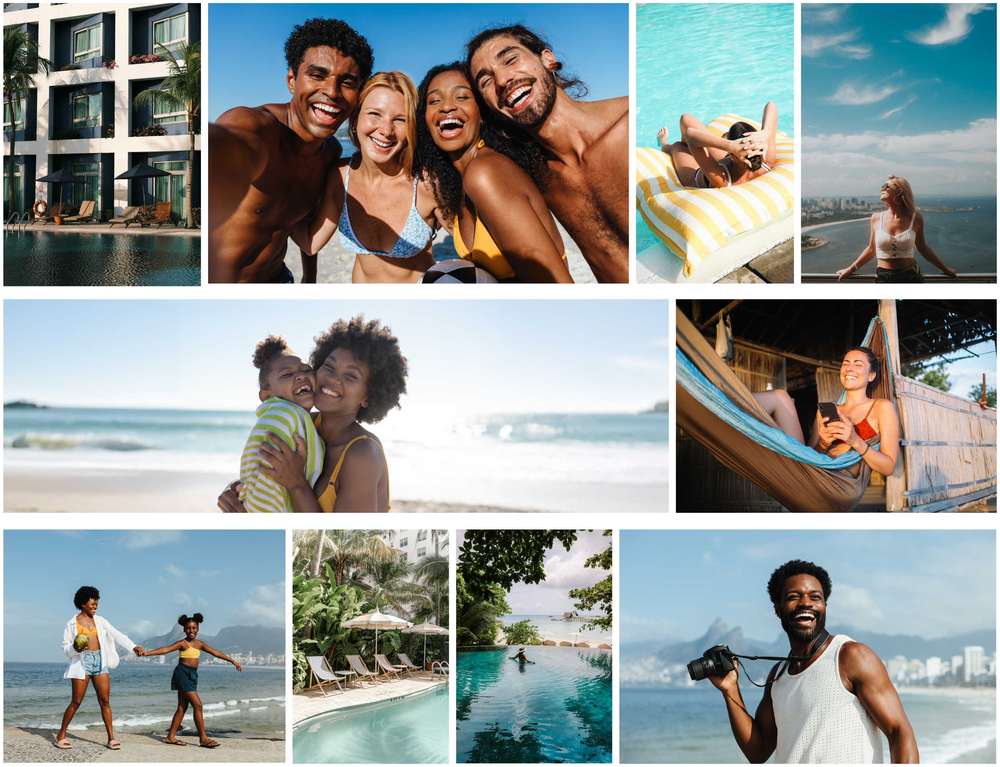

<!-- bloco 1 · fe37c1dc-2dcd-4811-87a6-b6fecee71fd4 · section -->

<!-- bloco 2 · 670dd8fd-5dd0-4434-ace1-a489edfbca7c · section -->

<h2>PRINCÍPIOS</h2>

<!-- bloco 3 · f836106d-dbe1-42c6-8a08-b5c8c2b787d9 · section -->

A fotografia traduz a essência de viajar e o desejo que coloca cada pessoa em movimento. Mais do que mostrar destinos, nossa fotografia busca inspirar novas possibilidades, caminhos e comunicar experiências com mais conforto, qualidade e praticidade.

 

<!-- bloco 4 · cdb8a406-69f9-46fd-94a1-9bbae7176766 · section -->

<h3>Explorador</h3>
Inspira a liberdade de viver e explorar novas experiências e lugares de forma prática.

<!-- bloco 5 · 68e595f4-0504-4fcd-9359-f4af2dce4a24 · section -->

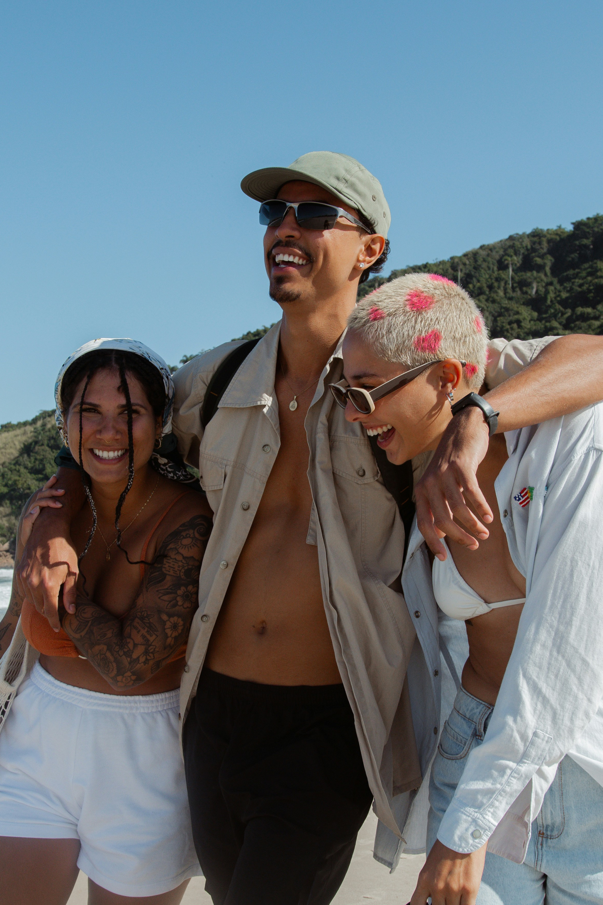

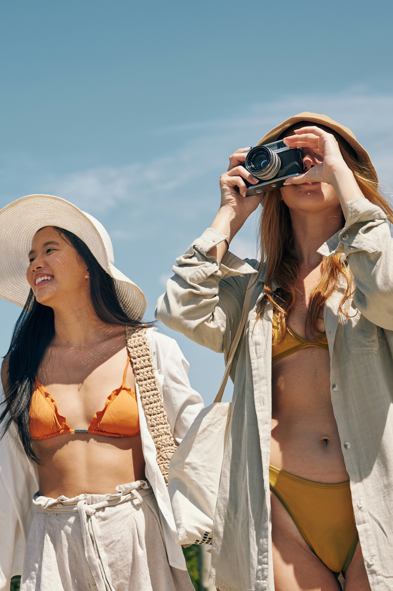

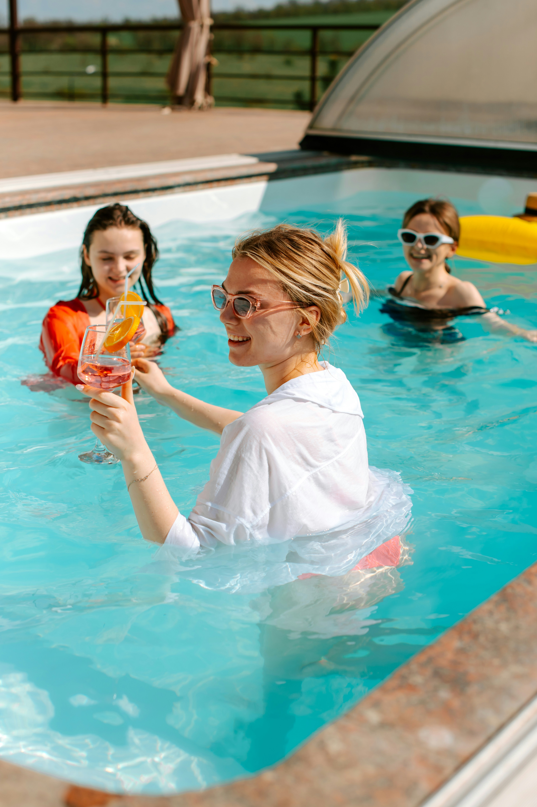

<!-- bloco 6 · 840b1edb-3995-4a4e-a798-7d077898a3e8 · section -->

<h3>Facilitador</h3>
Simplifica a jornada.

<!-- bloco 7 · fb8fd311-eb37-4402-be2b-f2467e077726 · section -->

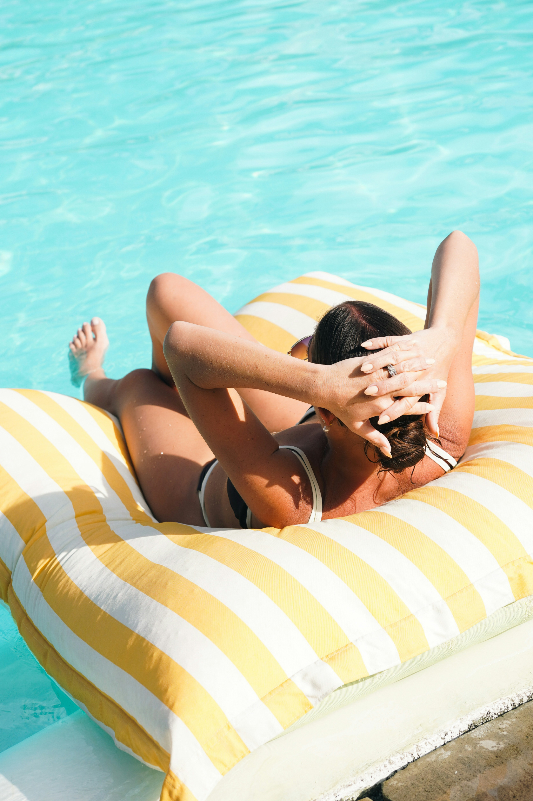

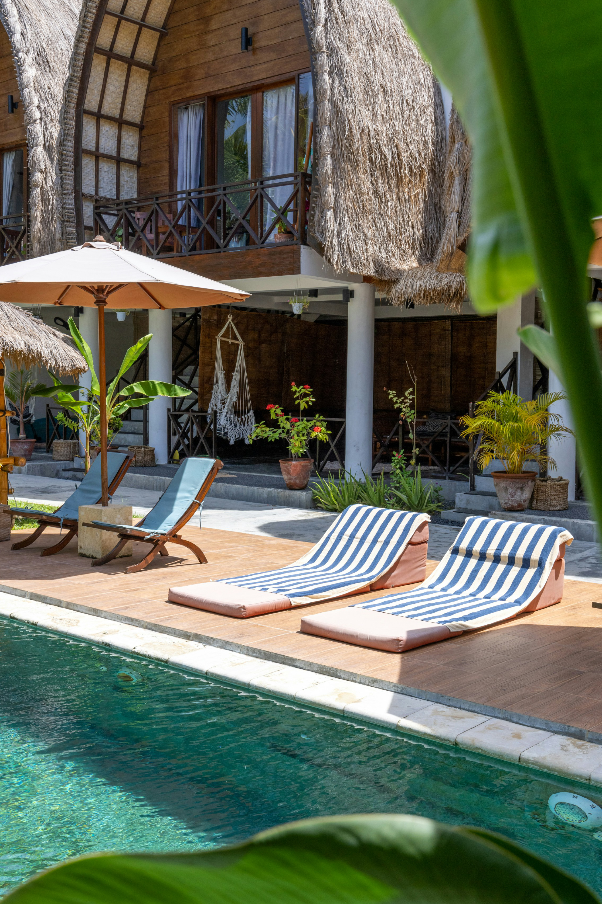

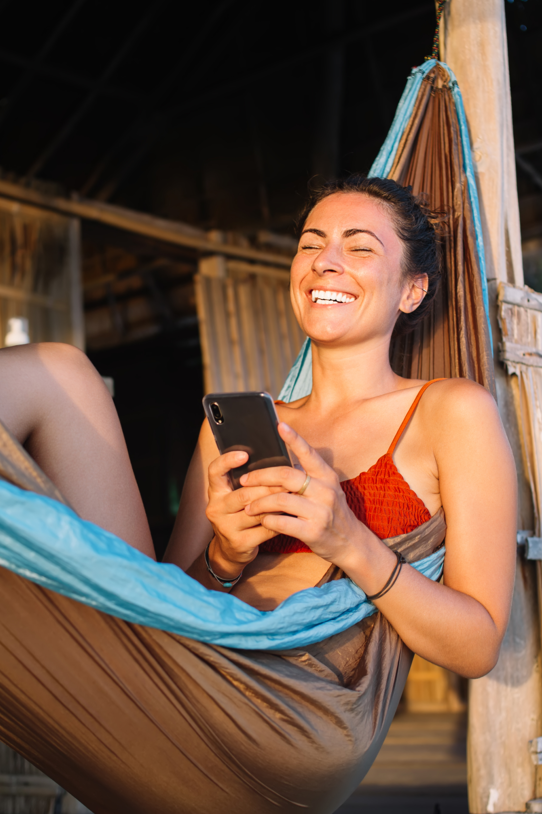

<!-- bloco 8 · 725f256f-6669-4217-af32-55510942ac9e · section -->

<h2>QUANDO USAR FOTOGRAFIA</h2>

<!-- bloco 9 · c124d36b-9b39-4570-a3c4-6d6436bfd136 · section -->

A fotografia é um elemento importante em nossos materiais de divulgação. É através dela que transmitimos motivações reais para viajar. Sempre buscamos incluir pessoas reais em primeiro plano, com poses naturais e espontâneas. Quando retratamos lugares, buscamos sempre um ponto de vista em “primeira pessoa” ao invés de perspectivas aéreas e distantes.

<!-- bloco 10 · 9cfb2607-ffe4-4a84-ba65-11fc50ac8fca · section -->

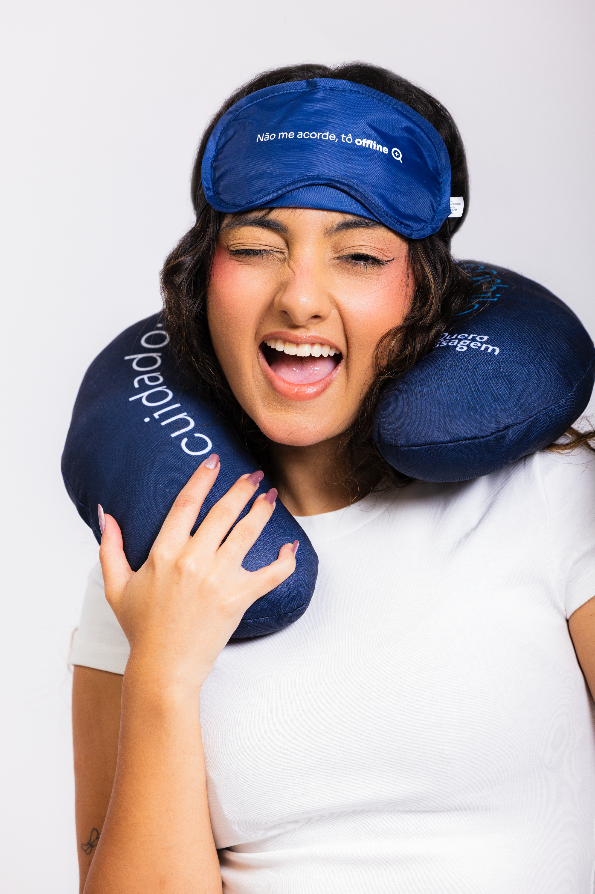

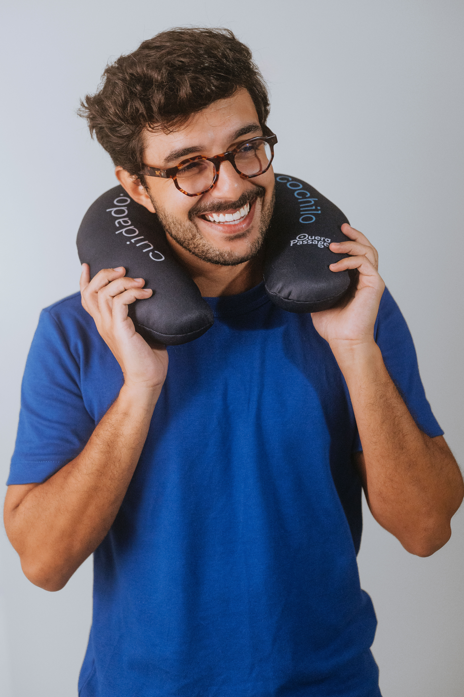

<!-- bloco 11 · 3c6d101a-1ae3-418d-bb5c-8abfe08fbef2 · section -->

<h2>PRODUTO</h2>

<h3>Passagens Rodoviárias</h3>

No produto rodoviário, a fotografia deve valorizar a experiência de viajar, destacando conforto, praticidade e os momentos que tornam cada trajeto parte da jornada.

<!-- bloco 12 · 66389f04-9b56-41da-af4e-c14732e0f5ad · section -->

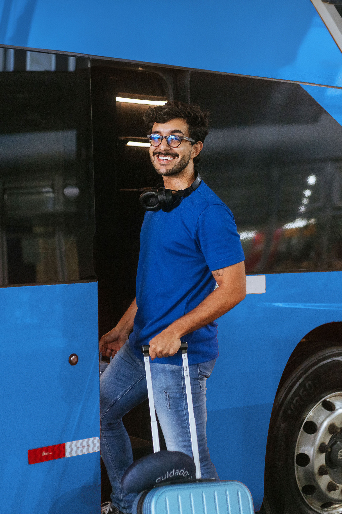

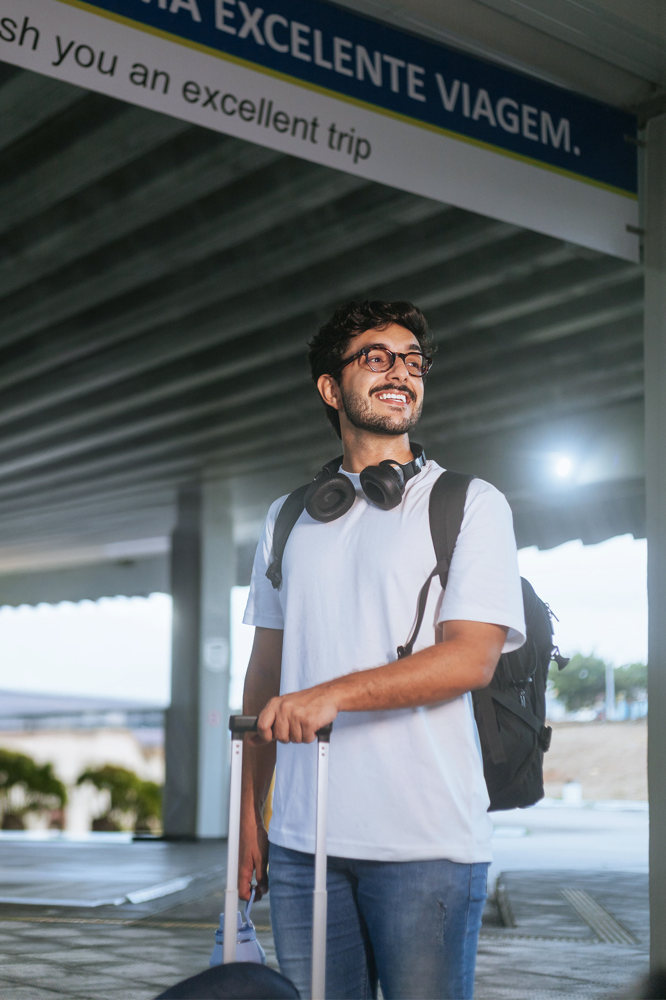

<!-- bloco 13 · fa6e0424-53a3-450d-8cf1-946a7311e61e · section -->

<h3>Sala VIP</h3>

Quando falamos de Sala VIP, a fotografia deve transmitir conforto, exclusividade e tranquilidade, valorizando os detalhes e as cores da paleta. 

<!-- bloco 14 · 129d8515-e217-4758-a92b-024bfba156a0 · section -->

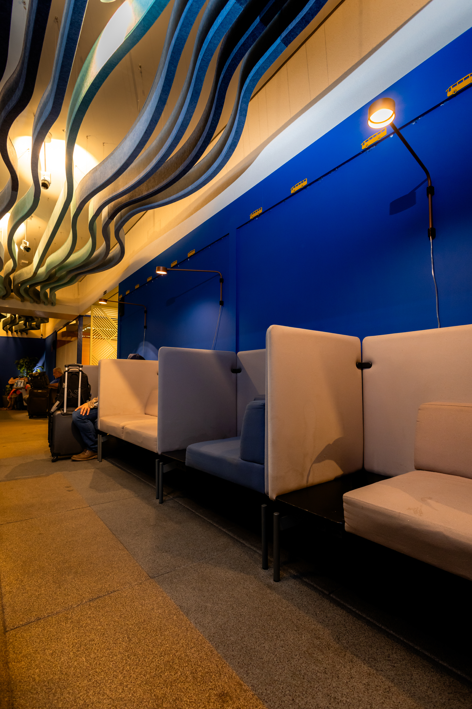

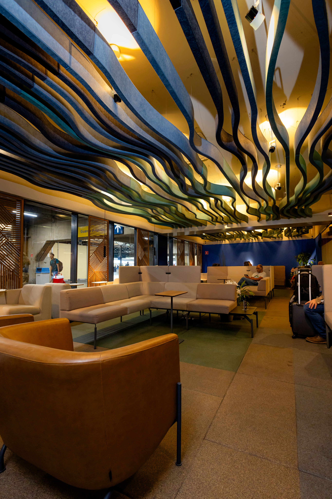

<!-- bloco 15 · 0726132f-a7fa-4023-ac3d-9b64b778ba69 · section -->

<h3>Hotéis</h3>

Queremos reforçar elegância, atenção aos detalhes e uma experiência de qualidade, sempre sem nos distanciarmos do público e da experiência real de quem vive a viagem e o destino que estamos mostrando.&nbsp;

<!-- bloco 16 · 63e58f4e-1c32-4226-8d41-26ee4d2ff3da · section -->

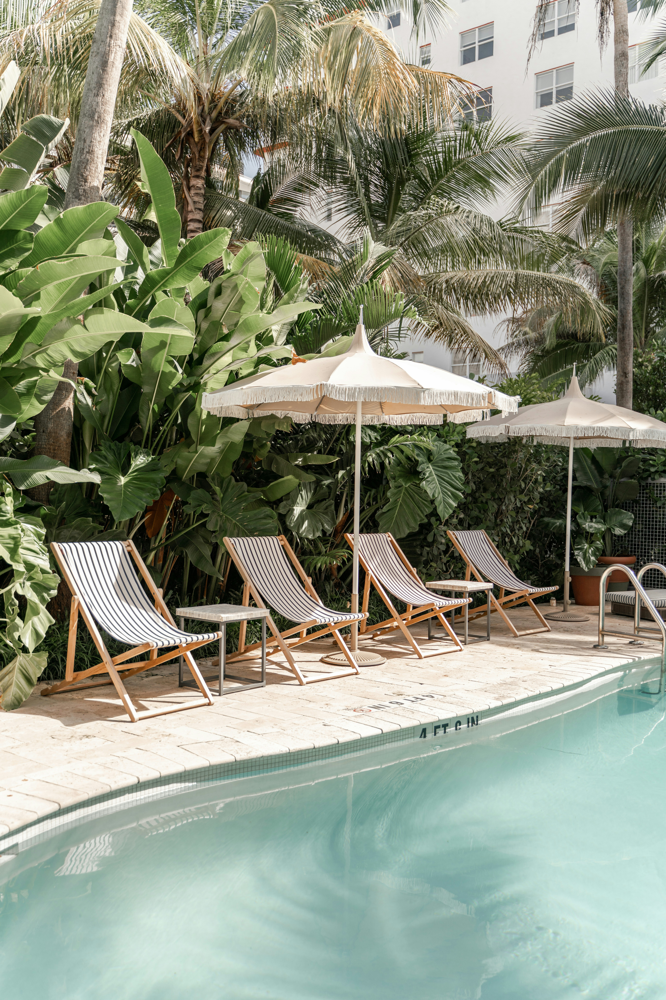

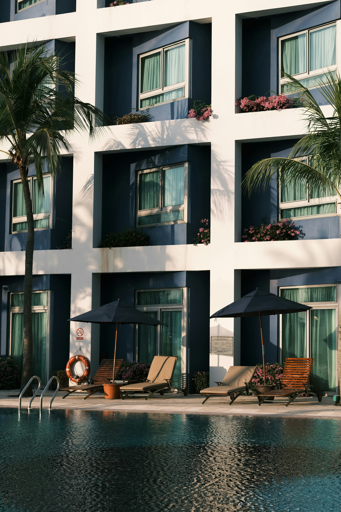
