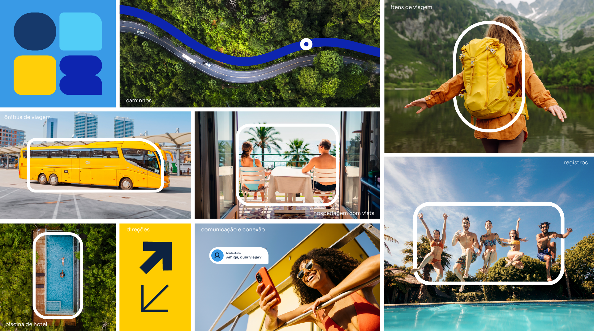
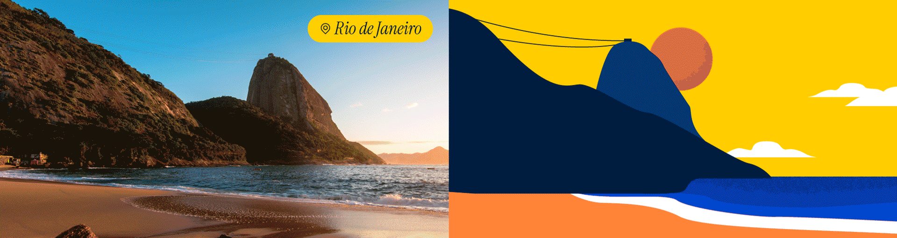
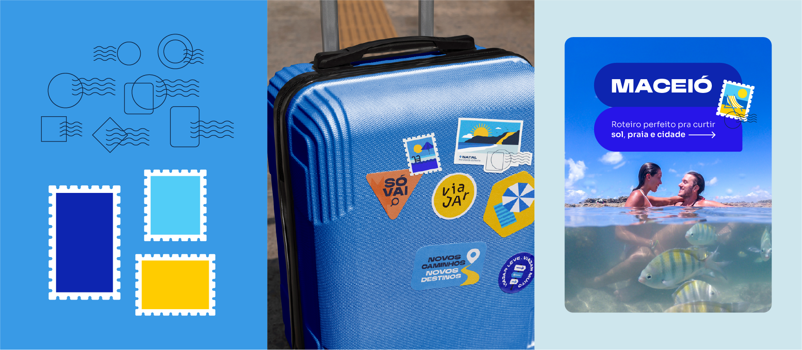
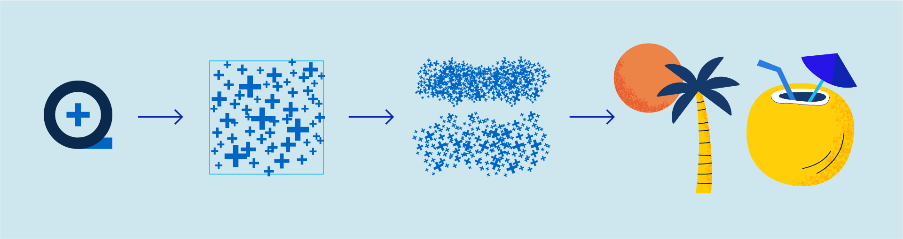
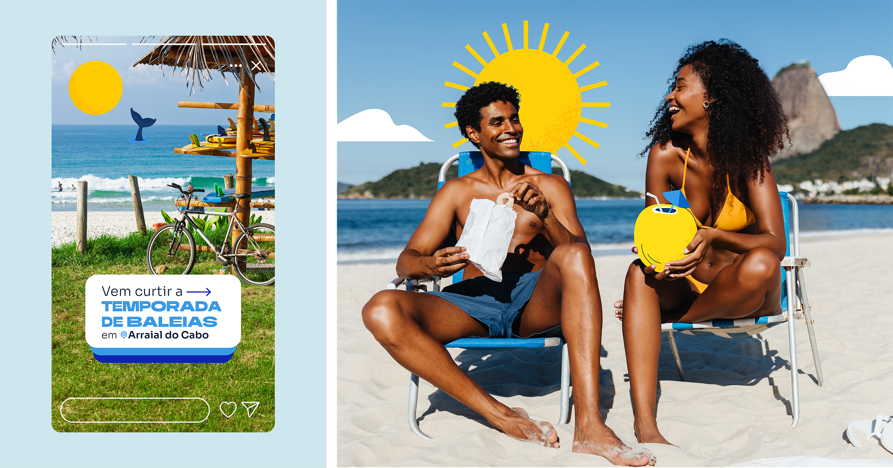

# Ilustração

Fonte: Brand Navigator /fundamentos/ilustracao. Atualização na origem: 2026-08-16T00:16:17.253246+00:00.

> Transcrição da página publicada. Exemplos de interface e dados ilustrativos permanecem exemplos; não são políticas comerciais.

<!-- bloco 0 · b2006096-f63d-4610-97f0-70ebc638e5fe · section -->

FORMAS E ELEMENTOS VISUAIS

inspirados no <strong>universo do viajante</strong>.

Formas e elementos visuais inspirados no universo do viajante

<!-- bloco 1 · 7e4d1f81-6d12-47a7-97c1-9069450038e7 · section -->

DESTINOS

pra quem sabe <strong>onde quer chegar</strong>.

<!-- bloco 2 · 8b37ec15-56d0-406f-aa7f-cb7817e6c818 · section -->

SELOS DE VIAGEM

que possibilitam <strong>infinitas combinações</strong>.

<!-- bloco 3 · 0b238c1d-94af-472a-a79a-02ab72fd9221 · section -->

TEXTURA

porque pra gente cada detalhe <strong>importa</strong>.

<!-- bloco 4 · 5dcee2ab-0845-4ece-9835-54b1e61e7051 · section -->

ILUSTRAÇÃO NA FOTOGRAFIA

para apoiar o que <strong>queremos comunicar</strong>.

