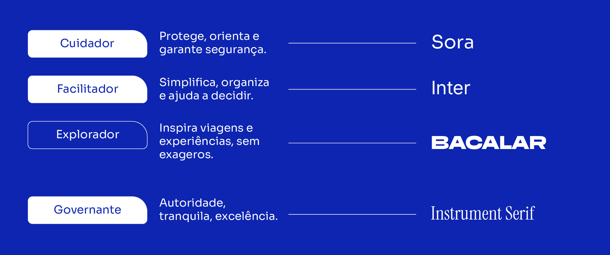
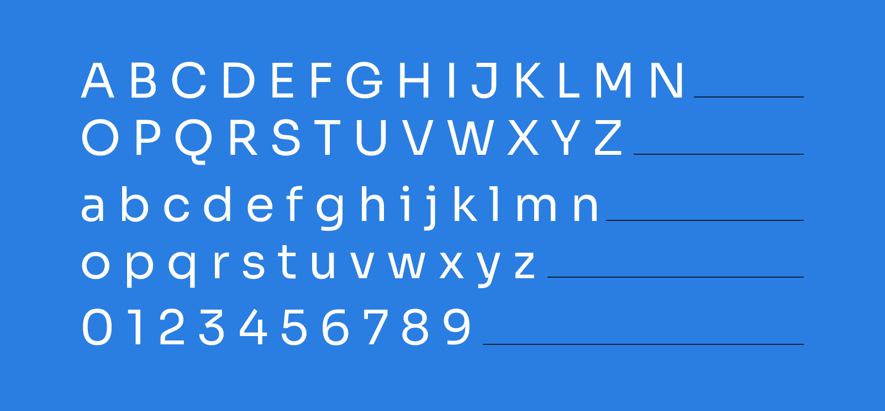
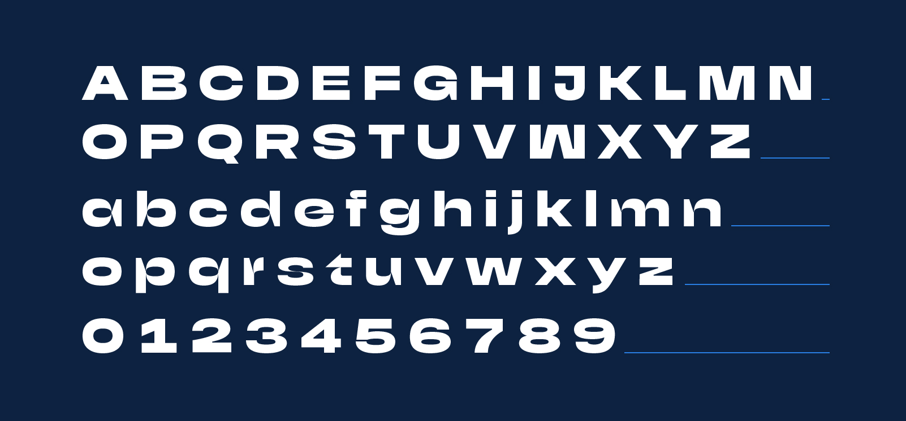
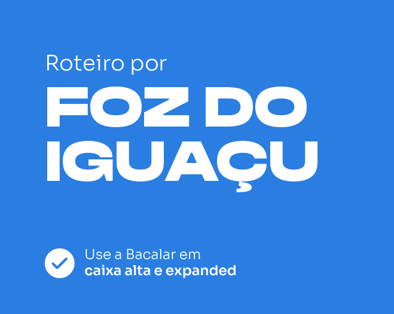
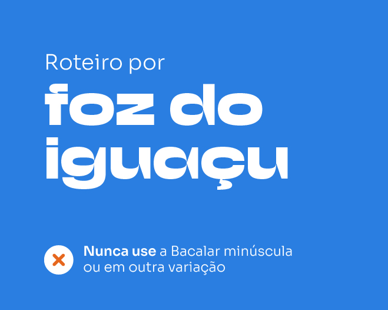
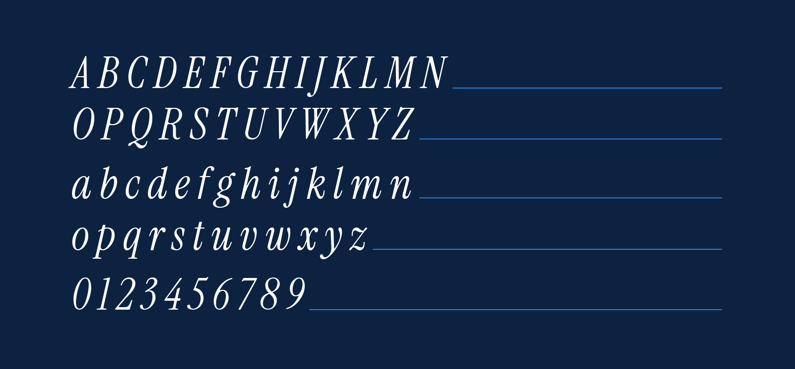
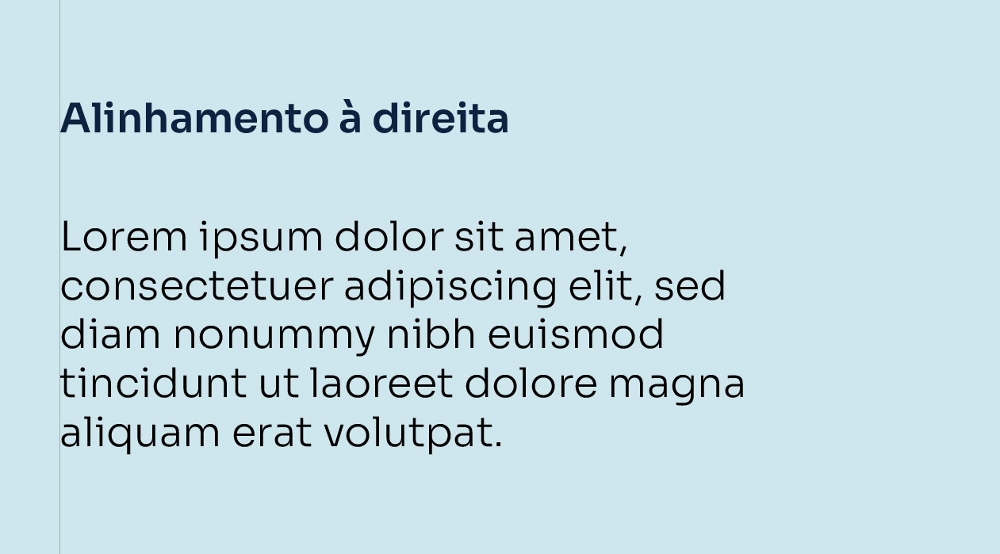
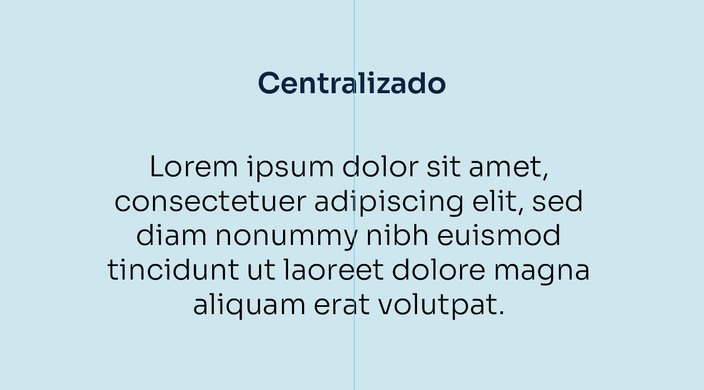
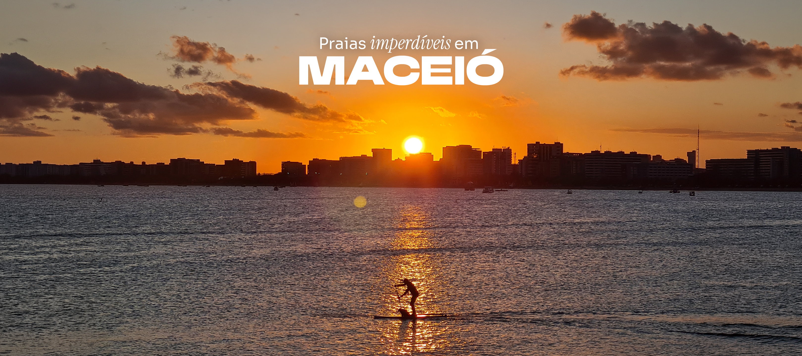

# Tipografia

Fonte: Brand Navigator /fundamentos/tipografia. Atualização na origem: 2026-08-11T20:26:30.173772+00:00.

> Transcrição da página publicada. Exemplos de interface e dados ilustrativos permanecem exemplos; não são políticas comerciais.

<!-- bloco 0 · cd7a7d40-67fb-4ea0-a69b-d29b306b966d · section -->

A escolha tipográfica leva em consideração a comunicação verbal da Quero Passagem. Prioriza a simplicidade, objetividade, excelência e inspiração, sem exageros.

ARQUÉTIPOS E TIPOS

A <strong>identidade verbal e identidade tipográfica</strong> da marca se aliam para construir uma comunicação coerente e organizada, de acordo com a mídia ou produto.

<!-- bloco 1 · f689a6e7-5e99-48f3-821d-c268560f448d · section -->

<!-- bloco 2 · 79b3a201-d6f1-4bbb-a757-4e238efec7f7 · section -->

FONTES

Cada família tipográfica cumpre uma função na comunicação aliada à personalidade da marca.

<!-- bloco 3 · ee4f9bbf-2949-452a-8151-de2b59a6cc45 · section -->

<h2>SORA</h2>
Fonte primária

Assim como os arquétipos do <strong>Cuidador e do Facilitador</strong>, a Sora compõe o sistema de tipografias da marca para trazer facilidade e conforto na leitura digital. Está presente na maior parte dos textos longos, trazendo uma <strong>leitura acessível e simplificada.</strong>

<!-- bloco 4 · 12aac06f-88fa-42d7-ad87-a696e96e63c1 · section -->

<!-- bloco 5 · ae4e13fd-7185-4697-9046-0e3722913494 · section -->

<h2>INTER</h2>
Corpo do texto

É usada no corpo dos textos, materiais gráficos e componentes do site e aplicativo. Traz <strong>conforto visual e facilidade</strong> na leitura gráfica e digital.

<!-- bloco 6 · 2f6e8d81-2119-4090-878a-1c358bf5258f · section -->

<!-- bloco 7 · 67b5d38a-bc48-4316-b98a-c2fc103444da · section -->

BACALAR

Fonte de apoio

Alinhada com o arquétipo do <strong>Explorador</strong>, a Bacalar tem presença nos títulos ou palavras-chave das comunicações da marca. Sua variação expandida traz peso e explora sua construção padrão, <strong>sem exagerar muito.</strong>

<strong>Sempre usada em caixa alta.</strong>

<!-- bloco 8 · d7e4105c-ad0d-4da1-87f7-c949e2eacfdf · section -->

<!-- bloco 9 · 633fc6f3-59d6-4155-a511-0f4dc20edb9c · section -->

<!-- bloco 10 · a8f87c8a-f95b-4451-8bc1-21d9717af7b7 · section -->

Instrument Serif

Fonte de apoio

Com intuito de expressar a presença do arquétipo <strong>Governante</strong>, a Instrument Serif na variação Itálica é a tipografia que remete à autoridade, ao que é diferente do comum. Ela busca comunicar <strong>excelência e tranquilidade.</strong>

<!-- bloco 11 · a931f585-5bb0-443e-9e39-e976fcbe6ced · section -->

<!-- bloco 12 · 9062537e-104f-4365-bd85-4c1b5a9e1121 · section -->

ALINHAMENTO

Podemos alinhar textos longos à esquerda e centro. Devemos evitar justificar e alinhá-los à direta, a fim de manter uma leitura simples e facilitada.

<!-- bloco 13 · 45001ae4-6667-4200-8354-4350310b0b17 · section -->

<!-- bloco 14 · afb87520-881d-4811-bca1-c1d94db70230 · section -->

MISTURANDO TIPOS

Para criar peças dinâmicas e com personalidade, podemos usar mais de uma tipografia na construção visual.

<!-- bloco 15 · 83c77227-858c-47b9-bc72-dda6746379b4 · section -->

<em>Sora Light + Instrument Serif Italic + Bacalar Expanded Caixa Alta</em>

<!-- bloco 16 · ba5ec244-828d-4814-84e7-4ebd88f983b3 · section -->

<em>Bacalar Expanded Caixa Alta + Sora Light + Instrument Serif Italic</em>

